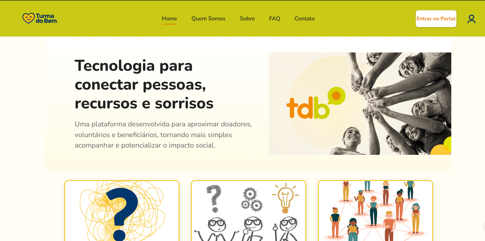
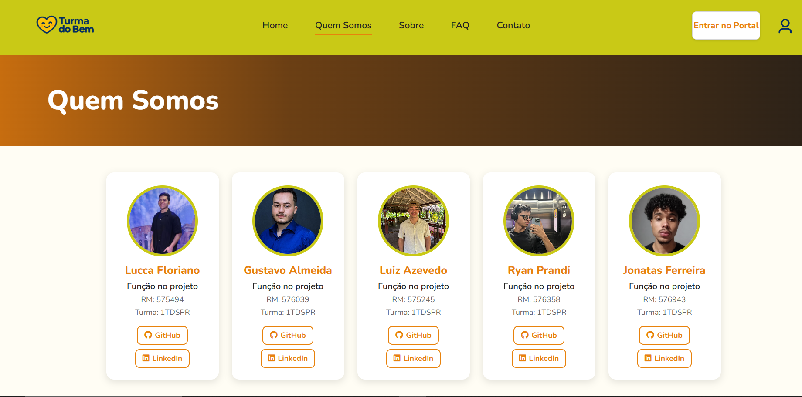
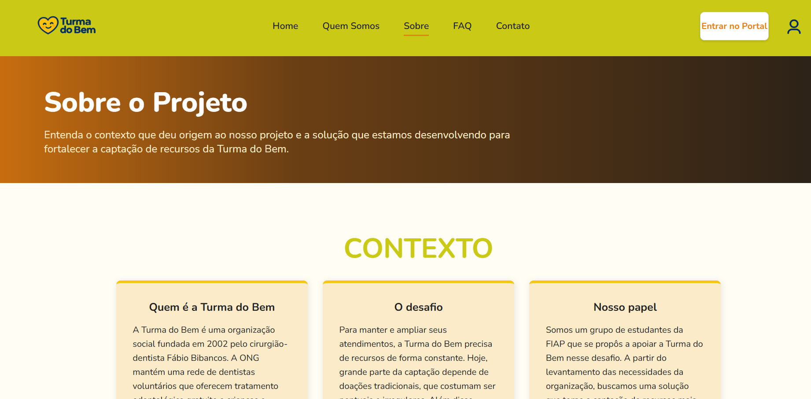
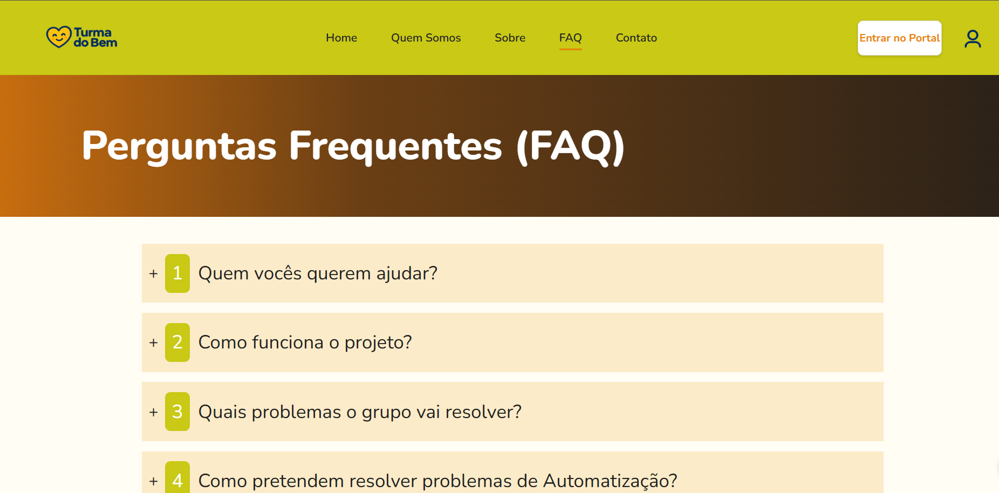
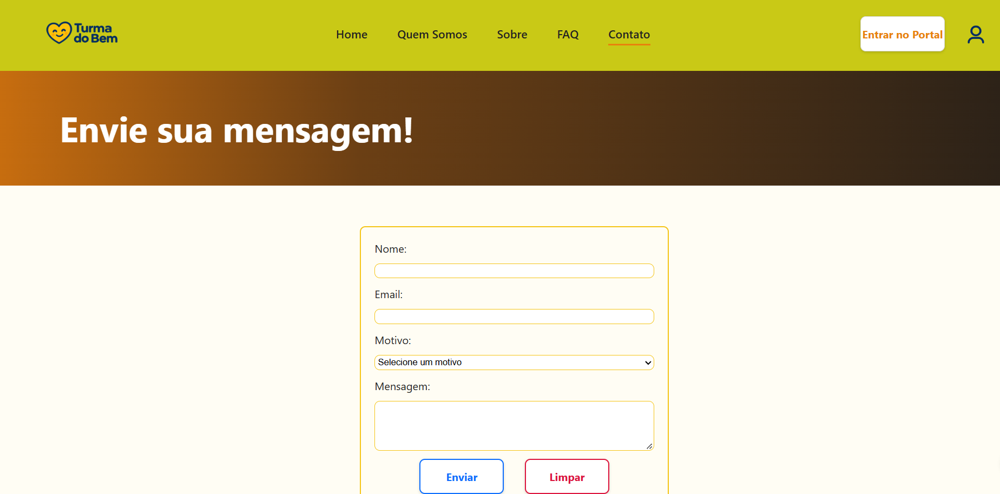

# 💙 Portal Turma do Bem

> Projeto desenvolvido para a Sprint 01 da disciplina de **Front-End Design Engineering**.

---

## 📌 Sumário

1. [Título e Descrição](#-1-título-e-descrição)
2. [Problema Abordado e Solução](#-2-problema-abordado-e-solução)
3. [Tecnologias Utilizadas](#-3-tecnologias-utilizadas)
4. [Estrutura de Pastas do Projeto](#-4-estrutura-de-pastas-do-projeto)
5. [Autores e Créditos](#-5-autores-e-créditos)
6. [Imagens e Ícones Relacionados ao Projeto](#-6-imagens-e-ícones-relacionados-ao-projeto)
7. [Link do Repositório do GitHub](#-7-link-do-repositório-do-github)
8. [Contato](#-8-contato)

---

## 📖 1. Título e Descrição

O **Portal Turma do Bem** é uma plataforma web voltada para promover o acesso à saúde bucal, conectando voluntários, beneficiários e apoiadores de causas sociais relacionadas à odontologia.

O sistema apresenta a proposta da organização, fornece informações transparentes, assegura navegação fluida entre seções desktop e disponibiliza canais de comunicação estruturados.

---

## 💡 2. Problema Abordado e Solução

- **Problema:** A carência de acesso a tratamento odontológico adequado para populações em situação de vulnerabilidade social e jovens em busca de oportunidades.
- **Solução:** Uma interface web em HTML5 e CSS3 que centraliza informações institucionais, propicia uma experiência imersiva e evidencia a atuação da rede de dentistas parceiros.

---

## 🚀 3. Tecnologias Utilizadas

De acordo com as diretrizes técnicas da Sprint 01:

- **HTML5 Semântico:** Estruturação lógica das páginas com elementos como `<header>`, `<nav>`, `<main>`, `<section>` e `<footer>`.
- **CSS3 Puro:** Estilização sem utilização de frameworks externos, como Bootstrap ou Tailwind CSS[cite: 4], estruturada para resoluções desktop (`≥992px` e `≥1300px`).
- **Git e GitHub:** Ferramentas de versionamento, controle de histórico e colaboração em equipe.

---

## 📁 4. Estrutura de Pastas do Projeto

A organização interna dos diretórios e arquivos do repositório segue a estrutura abaixo:

```text
Portal_Turma_do_Bem/
├── css/
│   └── contato.css
│   └── faq.css
│   └── quemsomos.css
│   └── sobre.css
│   └── style.css      
├── Img/
│   └── contato.png
│   └── css.png
│   └── faq.png
│   ├── Gustavo.png
│   └── home.png
│   └── html.png
│   └── icon.ico
│   └── icon.png
│   └── iconePerfil.png
│   └── impacto.png
│   └── java.png
│   ├── Jonatas.png
│   └── logo.pnh
│   ├── Lucca.png
│   ├── Miguel.png
│   └── python.png
│   └── quemsomos.png
│   └── roadmap.png
│   └── ryan.png
│   └── sobre.png
│   └── solucao.png
│   └── sql.png
│   └── TDB.png   
├── index.html              
├── sobre.html               
├── quemsomos.html
├── faq.html
├── contato.html
└── README.md
```

---

## 👥 5. Autores e Créditos

Identificação dos membros da equipe de desenvolvimento, incluindo nomes completos, RMs, turmas, fotos e links para redes profissionais.

| Foto | Nome Completo | RM | Turma | Redes / Links |
| --- | --- | --- | --- | --- |
|  | Gustavo [Almeida] | RM [576039] | [1TDSPR] | [GitHub](https://github.com/goliveiraalmeida) / [LinkedIn](https://www.linkedin.com/in/goliveiraalmeida/) |
|  | Jonatas [Ferreira] | RM [576943] | [1TDSPR] | [GitHub](https://github.com/jonatazf) / [LinkedIn](https://www.linkedin.com/in/jonatazf/) |
|  | Lucca [Floriano] | RM [575494] | [1TDSPR] | [GitHub](https://github.com/luccafloriano-7) / [LinkedIn](https://github.com/luccafloriano-7) |
|  | Luiz [Azevedo] | RM [575245] | [1TDSPR] | [GitHub](https://github.com/lazevedo2000-sudo) / [LinkedIn](https://github.com/lazevedo2000-sudo) |
|  | Ryan [Prandi] | RM [576358] | [1TDSPR] | [GitHub](https://github.com/prandiryan) / [LinkedIn](https://www.linkedin.com/in/ryan-prandi) |

---

## 🎨 6. Imagens e Ícones Relacionados ao Projeto

### Identidade Visual

O projeto utiliza elementos gráficos armazenados na pasta `Img/`, traduzindo a identidade visual da Turma do Bem por meio de logotipos e ícones personalizados.

### Capturas de Tela da Interface







---

## 🔗 7. Link do Repositório do GitHub

Acesse o código-fonte e o histórico de commits do projeto:

👉 [**Repositório Oficial no GitHub**](https://github.com/lazevedo2000-sudo/Portal_Turma_do_Bem)

---

## ✉️ 8. Contato

- **E-mail de suporte:** `contato@turmadobem.org.br`
- **Issues do repositório:** [Registrar ou consultar uma issue no GitHub](https://github.com/lazevedo2000-sudo/Portal_Turma_do_Bem/issues)

---

**Portal Turma do Bem**  
*Projeto acadêmico desenvolvido para a Sprint 01 de Front-End Design Engineering.*
